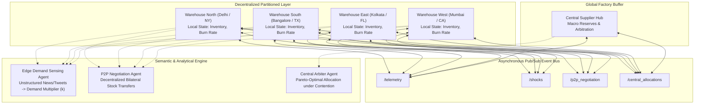

# DistriDemand-LLM: Multi-Agent Distributed E-Commerce Demand-Supply Analytics & Rebalancing

An end-to-end distributed analytics platform demonstrating **decentralized inventory state partitioning**, **asynchronous message passing (Pub/Sub)**, and **autonomous multi-agent LLM reasoning** across regional fulfillment centers.

---

## 🏛️ System Architecture



---

## 🎯 Distributed Analytics Concepts Implemented

1. **Partitioned Local State (Data Locality)**:
   - Each regional warehouse node maintains its own local inventory partition.
   - Nodes do NOT access shared mutable memory; all state synchronization occurs through the broker.
2. **Asynchronous Message Passing (Pub/Sub Event Bus)**:
   - Nodes publish and subscribe to discrete event channels (`telemetry`, `shocks`, `p2p_negotiation`, `central_allocations`).
   - Network transit latencies and cross-regional freight costs are modeled realistically.
3. **Decentralized P2P Coordination vs. Centralized Consensus**:
   - **P2P Rebalancing**: Deficit nodes autonomously discover surplus peers and negotiate stock transfers directly without bottlenecking on central authority.
   - **Central Factory Arbitration**: When aggregate network demand exceeds total supply, the Central Arbiter executes multi-criteria Pareto trade-offs to distribute scarce buffer inventory.
4. **LLM as the Semantic Analytical Engine**:
   - **Unstructured Signal Extraction**: Zero-shot parsing of news reports, tweets, and weather forecasts into quantitative demand multipliers ($k_{demand}$).
   - **Autonomous Multi-Agent Negotiation**: Simulates real-time bilateral reasoning balancing freight cost, transit lead-times, and local safety stock thresholds.
   - **Explainable AI (XAI)**: Generates human-auditable executive rationale for every automated allocation decision.

---

## 🧠 Real LLM Providers Supported

This project natively integrates with **local and cloud LLMs**:

1. **Local Ollama (Active & Auto-Detected)**:
   - Runs **100% locally and privately** on your machine.
   - Default model: `mannix/llama3.1-8b-abliterated:tools-q4_0` (or any model in your local Ollama library like `llama3`, `mistral`, `phi3`).
   - Uses Ollama's native JSON schema constraint (`"format": "json"`) for robust structured agent contracts.
2. **Cloud APIs (Optional)**:
   - **Google Gemini** (`gemini-1.5-flash`) via `GEMINI_API_KEY`.
   - **OpenAI** (`gpt-3.5-turbo` / `gpt-4o`) via `OPENAI_API_KEY`.
3. **Intelligent Offline Fallback**:
   - If Ollama is stopped or API limits are hit, the system seamlessly falls back to a deterministic rule-based heuristic engine with zero crashes.

---

## ⚡ Quickstart & How to Run

### 1. Launch the Interactive Dashboard (Streamlit)
Double-click `run_app.bat` or run in terminal:
```bash
.\.venv\Scripts\python.exe -m streamlit run app.py
```
*The interactive dashboard will open in your browser at `http://localhost:8501`.*

### 2. Run the Verification Checkpoints (CLI Unit Tests)
You can run any of the designated checkpoints directly:

* **Checkpoint 1 (Distributed Core & Broker):**
  ```bash
  .\.venv\Scripts\python.exe -m tests.test_broker
  ```
* **Checkpoint 2 (LLM Multi-Agent Reasoning):**
  ```bash
  .\.venv\Scripts\python.exe -m tests.test_llm_agents
  ```
* **Checkpoint 3 (Simulation Engine & Scenario Ingestion):**
  ```bash
  .\.venv\Scripts\python.exe -m tests.test_simulation
  ```

---

## 🧪 Demo Walkthrough for Professor Evaluation

1. **Baseline Operations**:
   - Open the dashboard at `http://localhost:8501`.
   - Click **"▶️ Advance 1 Day"** to observe organic daily demand and real-time burn rate updates.
2. **Inject a Demand Shock**:
   - In the sidebar, select **"📱 Viral Smartphone Trend (North)"** and click **"🚨 Inject Selected Shock"**.
   - Notice how the **Edge Demand Sensing Agent** parses the text into a `3.8x` surge for `SKU-PHONE` targeting `node_north`.
3. **Inspect Autonomous P2P Rebalancing**:
   - Click **"▶️ Advance 1 Day"** for 2–3 days.
   - Switch to the **"🤖 Multi-Agent Dialogue & LLM Rationale"** tab: see the live dialogue between Node North and Node West negotiating stock transfers.
   - In the **"🗺️ Regional Warehouses"** tab, notice the truck badge `(+120 🚚)` showing inbound stock in transit.
   - Check the **"📜 Broker Audit Ledger"** tab to inspect the immutable event log with millisecond latencies and channel routing.
4. **Custom Market Signal (Live Testing)**:
   - Type any custom event into the **"🧠 Custom Text Signal"** box (e.g. *"Early polar blizzard in North Hub triggers 3x spike in Winter Jacket orders"*) and click **"Extract & Inject via LLM"**!

---

## 🎓 Academic Defense Q&A Cheatsheet

* **Q: Why is this considered Distributed Analytics rather than a standard web app?**
  * **A:** *The core computation is distributed across autonomous node actors with partitioned local states. There is no central lock on inventory. Telemetry is streamed asynchronously via pub/sub channels, and stock balancing utilizes both decentralized peer-to-peer protocols and coordinated arbitration under latency constraints.*
* **Q: Why use an LLM instead of standard statistical forecasting (e.g. ARIMA)?**
  * **A:** *Statistical forecasting requires historical numerical time-series and fails during sudden black-swan events or unstructured real-world signals (e.g. breaking news, viral social media trends, supplier port strikes). The LLM functions as a zero-shot semantic sensor that translates qualitative world events into actionable quantitative elasticity parameters, and provides explainable reasoning for inter-node trade-offs.*
* **Q: Does this require an active internet connection or paid API key?**
  * **A:** *No. It features a built-in Intelligent Offline Heuristic Reasoning Engine that guarantees 100% crash-proof demonstration during evaluations, while also providing full support for live Google Gemini or OpenAI API keys.*
